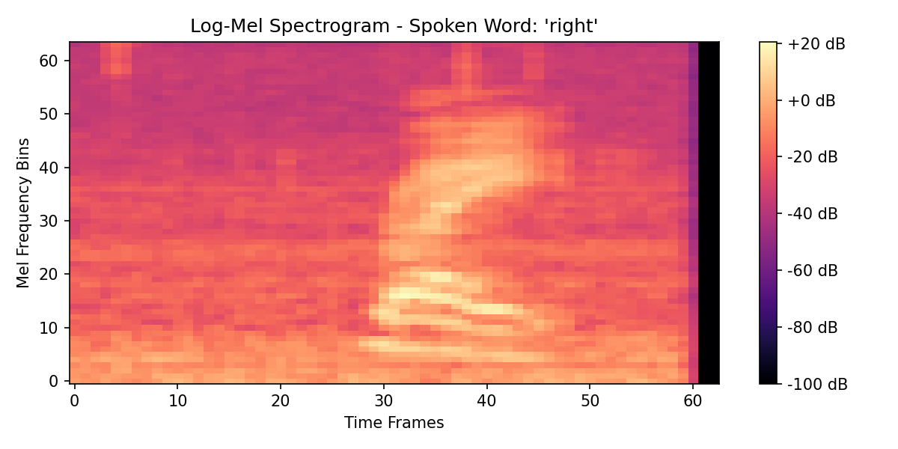
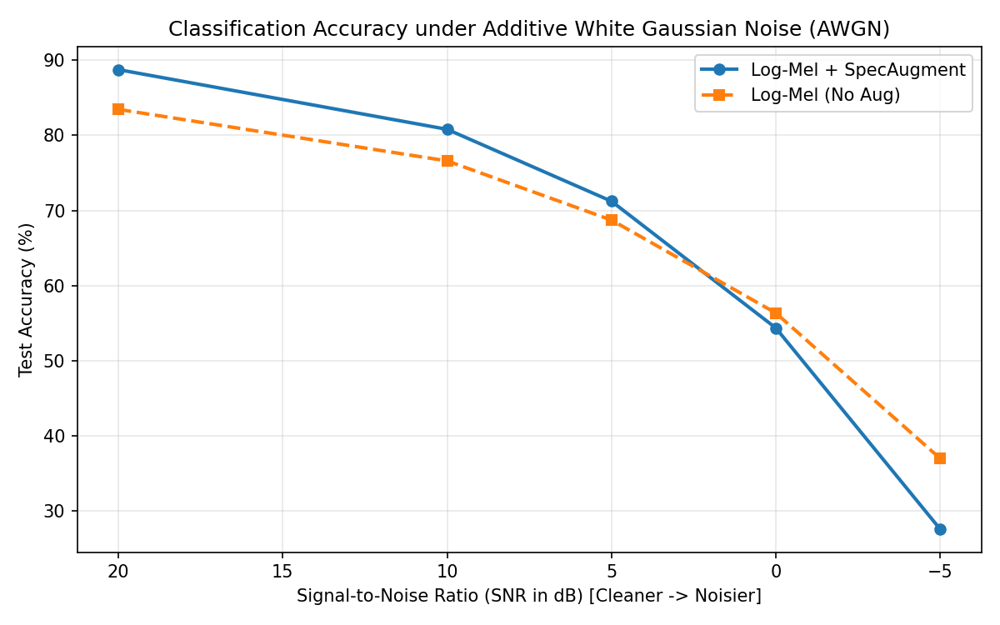

# Real-Time Speech Command Recognition & Channel Robustness Analysis

An end-to-end PyTorch audio classification pipeline trained on the **Google Speech Commands v0.02** dataset (105,829 utterances across 35 spoken command classes), bridging **Digital Signal Processing (DSP)** and **Deep Learning** to evaluate feature representations and acoustic noise robustness.

## Key Highlights & Results
* **92.34% Test Accuracy (91.78% Macro F1)** across 35 classes using Log-Mel Spectrograms + SpecAugment.
* **+4.83% Generalization Gain** from frequency and time masking (SpecAugment) over un-augmented spectrograms.
* **4.32 ms Average CPU Inference Latency** per 1-second audio clip (1.56 MB lightweight 4-block 2D CNN), enabling real-time edge deployment.
* **AWGN Channel Robustness Study:** Benchmarked model degradation across Signal-to-Noise Ratios (SNR) from **+20 dB to -5 dB**.

---

## Architecture & Signal Processing Pipeline
1. **Waveform Standardization:** 16 kHz mono audio standardized to 16,000 samples (1.0s) via zero-padding/truncation.
2. **Time-Frequency Representation:** Short-Time Fourier Transform (`n_fft=1024`, `hop_length=256`) mapped onto 64 Mel filterbanks (`Log-Mel Spectrogram`) vs. 40 `MFCC` coefficients.
3. **Data Augmentation:** GPU-accelerated `SpecAugment` (Frequency Masking `F=8`, Time Masking `T=16`).
4. **Model:** Compact 4-stage 2D Convolutional Neural Network (`Conv2d` $\rightarrow$ `BatchNorm2d` $\rightarrow$ `ReLU` $\rightarrow$ `MaxPool2d`) with Global Adaptive Average Pooling (~420K parameters).

---

## Experimental Ablation Results

| Model Variant | Input Representation | SpecAugment | Test Accuracy | Macro F1-Score |
| :--- | :--- | :---: | :---: | :---: |
| **Model 1 (Ours)** | Log-Mel Spectrogram (64 bins) | Yes | **92.34%** | **91.78%** |
| **Model 2 (Baseline)** | Log-Mel Spectrogram (64 bins) | No | 87.51% | 86.99% |
| **Model 3 (MFCC)** | MFCC (40 coefficients) | Yes | 91.16% | 90.29% |

---

## AWGN Noise Robustness Evaluation
To simulate real-world acoustic and communication channel interference, Additive White Gaussian Noise (AWGN) was injected into raw test waveforms across varying SNR levels:

**Research Observation:** SpecAugment consistently improves accuracy by **~3–5%** under clean to moderate noise conditions (`20 dB` to `5 dB`), demonstrating stronger invariance to spectral distortion before broadband noise dominates at negative SNRs (`0 dB` to `-5 dB`).

---

## Repository Structure
* `1st_Project.ipynb` — Full end-to-end training, GPU dataset caching, ablation experiments, SNR benchmarking, and latency profiling notebook.
* `audiocnn_mel_specaug.pth` — Trained PyTorch model weights (92.34% test accuracy).
* `sample_spectrogram.png` — Visualized Log-Mel spectrogram sample.
* `snr_robustness.png` — Accuracy vs. SNR (dB) robustness comparison plot.
